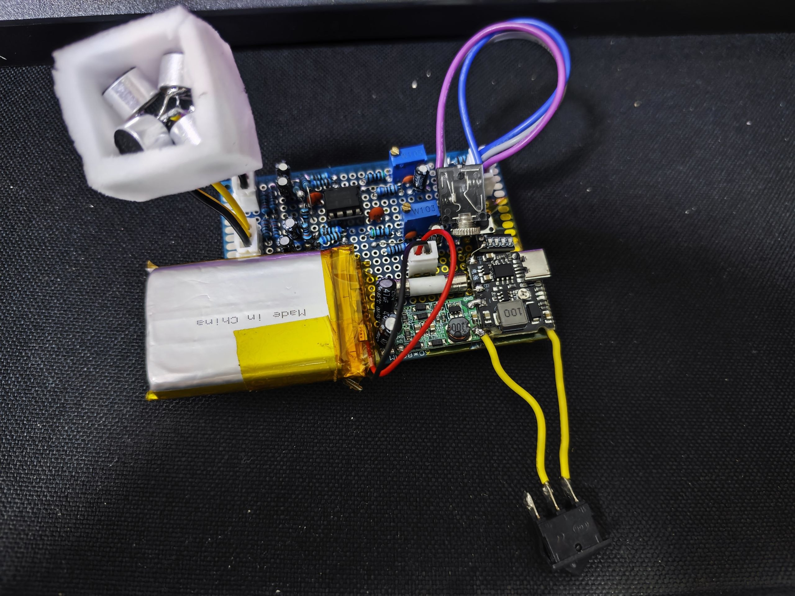
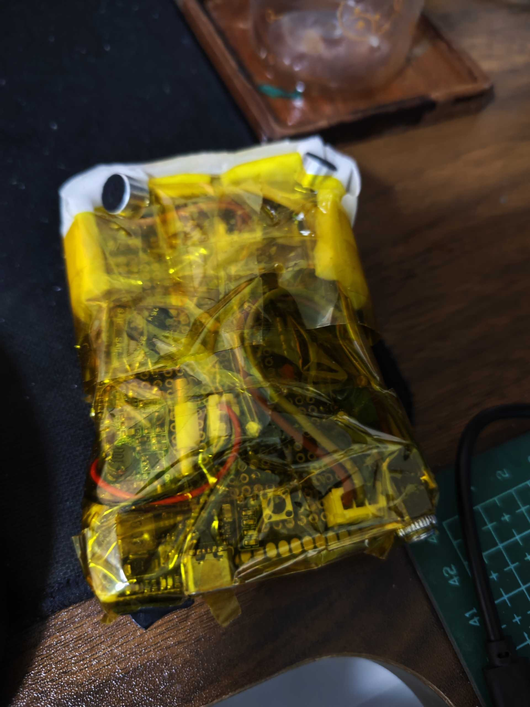
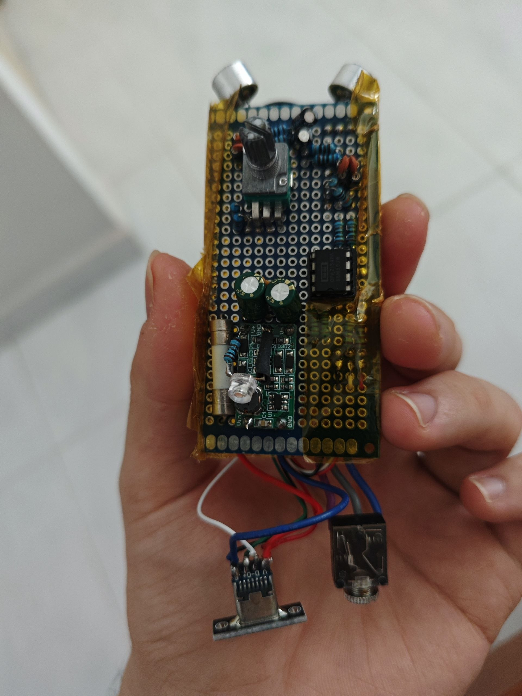
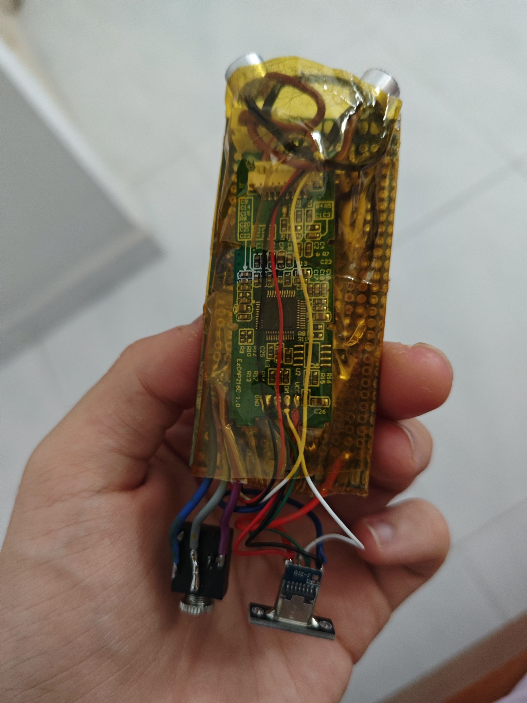
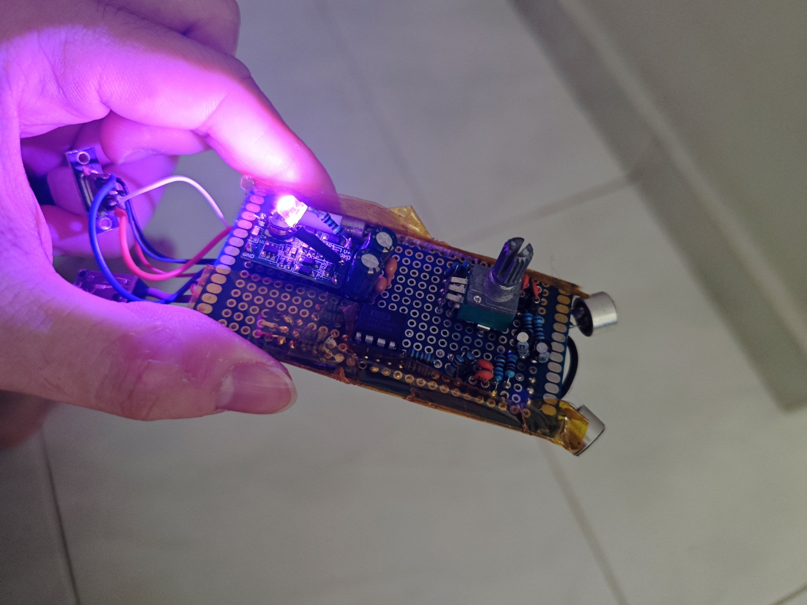
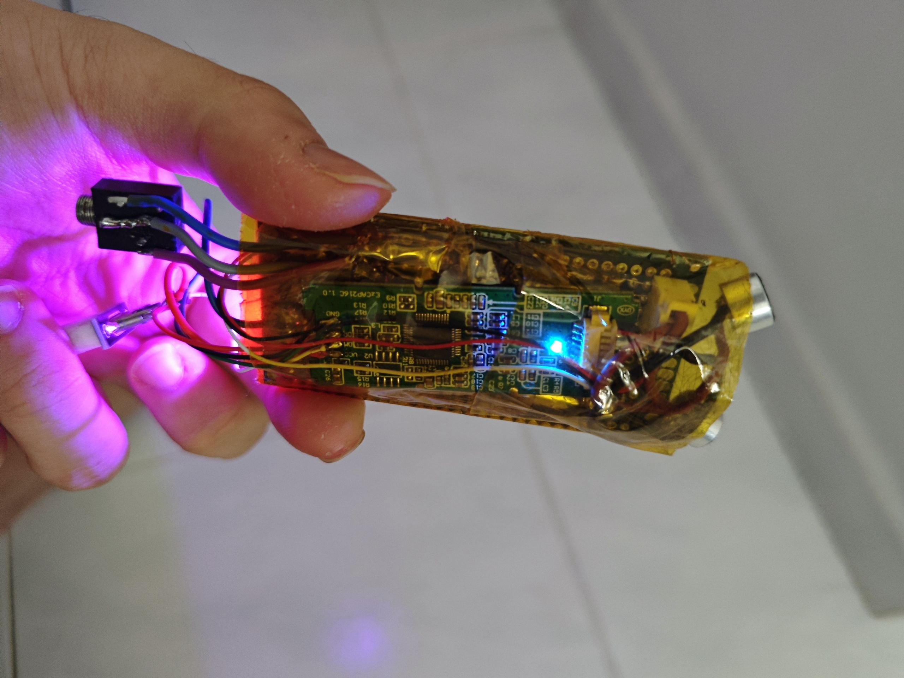
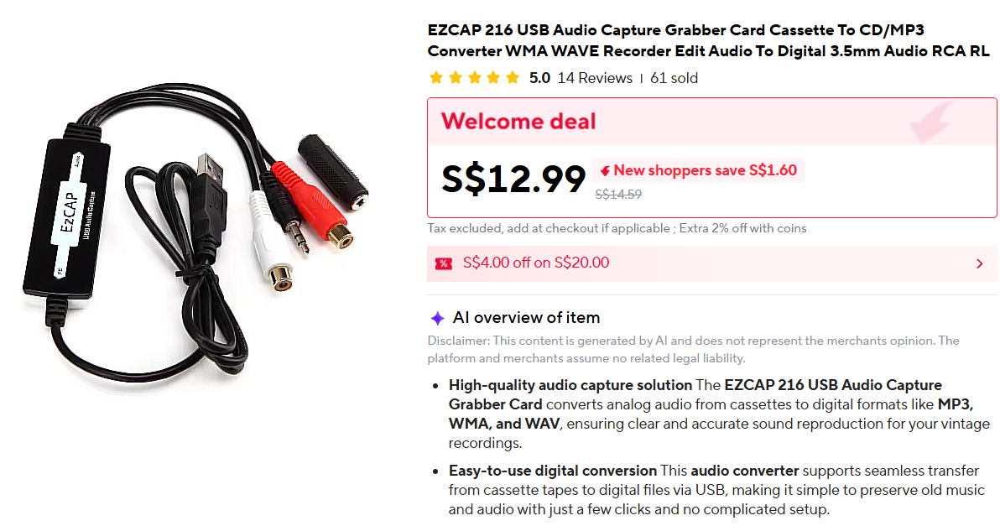
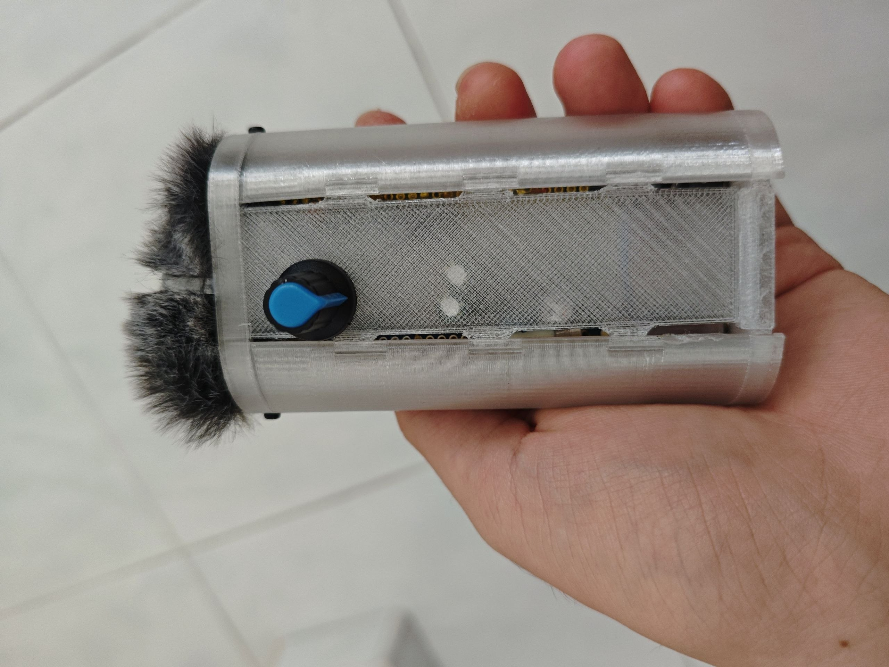
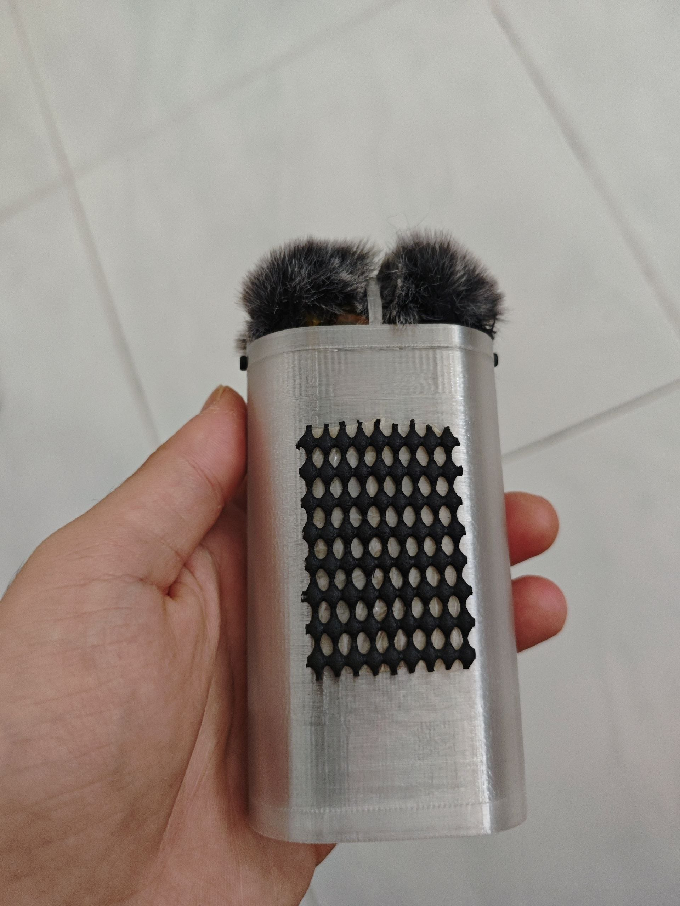

# Stereo Electret Mic

Inspired by MubarakNative [STUDIO-QUALITY ELECTRET MIC PREAMP BUILD](https://mubaraknative.github.io/build_instruction.html), but modified the original design completely. The base circuit is still a basic op-amp circuit.

# Version 1
## Modifications made from MubarakNative's design
- Use 4 mics in total, 2 left and 2 right for stereo input from the front and back (Left and right still correct even if the mic is flipped)
- Integrated multiturn trimmer potentiometer for fine tuning channel volume
- Added additional decoupling capacitor to the power rails and power rails of the op amp to reduce noise 
- Used a dual 9v power supply instead of a virtual ground using a voltage divider
- Additional LiPo battery to power the circuit. Portable. Uses a switch to turn on/off
- Used an OP2134 instead of NE5532 (Or any direct NE5532 should works)

| Completed | Enclosed? |
| :---: | :---: |
|  |  |

Old schematics can be found in the [schematics folder](/Old%20Design%20(Dual-stereo)/Mic%20Schematic)

# Version 2
## Modifications made from Version 1    
- Back to just 2 mics. Having the mic wired to the opposite channel behind of each side makes it hard to isolate left and right sound. Never had a use for speaking from the back anyway.
- Remove LiPo battery and used usb power instead
- More compact design
    - Half the wiring due to 2 mics instead of 4
    - No bulky battery, switch and charging board
- Added ADC module. Can connect to a computer via line-in or usb
- Added a potentiometer to adjust gain (up to 80). 2.2k fixed + 50k adjustable.
- Trial and error the best capacitor values to reduce noise. Cant be bothered to simulate with LtSpice

## Result
| Front | Back |
| :---: | :---: |
|  |  |
|  |  |

## Schematics
[here](/Schematic.png).

## Parts list

Electrical components:
- 2 x Electret Microphone (Any size should work)
- Repeat this for each channel:
    - 1/4W 1% Metal Film Resistor
        - 1x 680 Ohm Resistor
        - 2x 1k Ohm Resistor
        - 1x 2.2k Ohm Resistor
        - 1x 6.8k Ohm Resistor
        - 1x 10k Ohm Resistor
        - 1x 100k Ohm Resistor
    - Electrolytic Capacitor
        - 1x 10uF Capacitor
        - 3x 220uF Capacitor
    - Ceramic Capacitor
        - 1x 10nF Capacitor
        - 1x 150pF Capacitor
        - 3x 100nF Capacitor (Or MLCC if have)
- Op-amp (NE5532 or OP2134 or any direct replacement chip)
- 1x 50k Ohm duplex potentiometer for gain adjustment (6 pins, 3 for each channel)
- 1x 3.5mm TRS female jack for line-out (or any other connector you want to use)
- (Optional) 1x USB C module with 4 pins (VCC, GND, D+, D-)
- (Optional) 1x 1.5A fuse
- (Optional) LED for power indicator
- (Optional) 8-pin DIP socket for the op-amp chip 

Others:
- Prototype board
- Dual 9V power supply module.
- ADC with usb output. Example module from [Aliexpress](https://a.aliexpress.com/_c30hvoIB)
- A [Dead cat](https://purpledonutstudios.com/blog/the-mystery-behind-the-dead-cat-in-video-production/)
- (Optional) JST connectors (can be used between the electret mic, op-amp circuit and ADC board for easier replacement of each stage)

## How to build
1. See schematics and solder. Dont flip the polarised components. Google pinout for NE5532 op-amp.
2. Dismantle ADC module by taking it out of the plasic case

     

    If using USB C
    - Cut and strip the USB A output from the ADC module to expose the wires, VCC, GND, D+, D-
    - Solder the exposed wires to the USB C breakout board
    - (Optional) Add a fuse from between the USB C board and the module
    - **You just learned how to convert USB A to USB C**

    Wiring op-amp output
    - Remove the 3.5mm male jack (Wont be needing it)
    - Cut and strip the left and right output (Red and White)
    - Solder directly or connect to the op-amp output (see R11 and R17 in schematic)
3. (Optional) Connect the op-amp output to a 3.5mm female jack for line-out connection (or ASMR). **Do not use normally-closed type as it will short the output to the ADC to gnd as well.**
4. (Optional) Solder LED to dual 9V supply module input to see if powered on. Led on the ADC module will indicate when it is working.
5. Tape everything together. Make sure no metal touching the ADC and prototype board.

## Enclosure

Wont be sharing the STL file. Not because its a secret, but because it is very badly designed. It is absolutely not water proofed.

| Front | Back |
| :---: | :---: |
|  |  |

Issues i wont be fixing until the mic break and have to make a new one
- Dead cat barely holding together
- Massive gap in the side of the center panel
- Case too slippery, need an anti-slip mat.
- Capacitor too tall, pushing against the center panel. Panel cannot be pushed down any further, causing blue knob of the gain adjuster barely connected (Can see top of capacitor pressed against the cover).
- Cant stand up during operation since the cables are connected at the bottom
- USB C to USB C power does not work. Need to be A to C.

# Notes
Works great. Can put it across my table and speak normally, even if lying down. No echo from far.

Stereo function works well when close, without needing a trimmer pot to fine tune gain on each channel. Can do self asmr if you are weird

Very little noise at lower gain, huge improvement from version 1. At higher gain, noise is eliminated using software such as OBS or noise suppression on zoom or msteams.

Sound quality better than any laptop, camera or phone mic. Not an expert in sound, thus no proper analysis is available nor can i compare with actual microphone. 

Good enough for what i need
